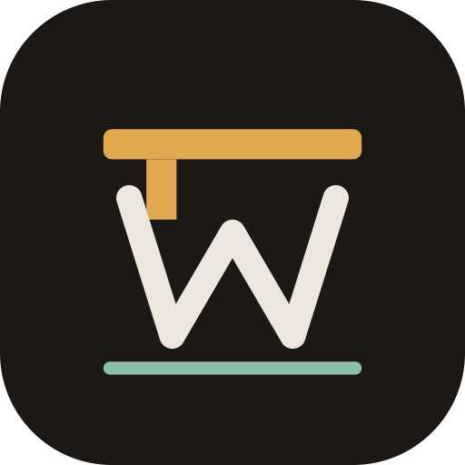

<p align="center">
  
</p>

<h1 align="center">TresenWerk Team</h1>

<p align="center">
  Rezepte, Flaschenbestand und Kalkulation für professionelle Bartender – als Android-App.<br>
  Offline nutzbar – gemeinsame Daten für das Team über den eigenen Webspace (geplant).
</p>

<p align="center">
  Version 0.6.0 (in Entwicklung) · Android 8 oder neuer · Kotlin + Jetpack Compose
</p>

---

> **Team-Variante von TresenWerk.** Ziel: Mehrere Geräte einer Bar teilen Rezepte und Bestand über einen
> eigenen Webspace, mit Benutzerverwaltung. Plan: [docs/Konzept-Serveranbindung.md](docs/Konzept-Serveranbindung.md).
>
> Die reine Offline-Variante wird im Repository **TresenWerk** weitergeführt. Diese Variante ist eine Kopie davon
> und hat eine eigene App-Kennung (`de.tresenwerk.team`), damit beide nebeneinander auf einem Handy laufen.
> Bis die Serveranbindung fertig ist, funktioniert sie genau wie die Offline-Variante.

## Fehlerkorrekturen aus der Offline-Variante übernehmen

Das Original ist als `upstream` eingetragen (nur lesen, Hochladen dorthin ist gesperrt):

```bash
git fetch upstream
git merge upstream/main
```

## Funktionen

**Rezepte**
- Specs mit Zutaten (ml, cl, oz, Dash, Tropfen, Barlöffel, Stück, Auffüllen), Methode, Glas, Eis, Garnitur, Tags, Foto und Notizen
- Volltextsuche über mehrere Wörter, Filter nach Favoriten, Methode, Tags und „Kann ich mixen“
- Batch-Rechner: Portionen hochrechnen, Umrechnung ml/cl/oz, Verdünnung für Pre-Batches
- Kosten pro Drink aus den Flaschenpreisen und Verkaufspreis-Richtwert bei 15–30 % Wareneinsatz
- Rezept als Text teilen

**Bar-Bestand**
- Etikett scannen: Texterkennung auf dem Gerät schlägt Name, Größe, % vol und Sorte vor
- Barcode scannen und bei [Open Food Facts](https://world.openfoodfacts.org) nachschlagen
- Wiedererkennen vorhandener Flaschen (per Barcode oder Etikett): aktualisieren, Anzahl +1 oder neues Produkt
- Anzahl Flaschen und Füllstand der angebrochenen Flasche, Füllstand-Messung am Foto
- Filter „Nachkaufen“ und teilbare Einkaufsliste

**Daten**
- Sicherung als ZIP-Datei inklusive Fotos, Einlesen auf jedem Gerät
- Inventur als CSV für den Steuerberater (Bestand, Einkaufspreis netto, Warenwert, Summe – direkt in Excel lesbar)

## Datenschutz und Sicherheit

- Kein Konto, keine Werbung, keine Nutzungsstatistik
- Texterkennung und Barcode-Lesen laufen lokal (Google ML Kit); dessen Telemetrie ist im Manifest entfernt
- Ins Internet geht nur die Barcode-Nummer (HTTPS, Open Food Facts)
- Inventur-CSV ist gegen Excel-Formeln abgesichert, der Import gegen manipulierte Sicherungen

Details: [ANLEITUNG.md → Sicherheit und Datenschutz](ANLEITUNG.md#sicherheit-und-datenschutz)

## Technik

| Bereich | Verwendet |
|---|---|
| Sprache, Oberfläche | Kotlin 2.4, Jetpack Compose (Material 3) |
| Datenbank | Room 2.8 (Version 4, mit Migrationen) |
| Bilder | Coil 3 |
| Texterkennung, Barcodes | Google ML Kit (gebündelte Modelle, offline) |
| Build | Gradle 9.9, Android Gradle Plugin 9.5, KSP |
| Android | minSdk 26, targetSdk 36, compileSdk 37 |

## Bauen

Voraussetzungen: JDK 17 oder neuer, Android SDK (Pfad in `local.properties`, z. B. `sdk.dir=/home/<name>/Android/Sdk`).

```bash
# Entwicklerversion bauen und auf ein per USB verbundenes Handy installieren
./gradlew installDebug

# Tests
./gradlew testDebugUnitTest
```

Die Entwicklerversion heißt auf dem Handy **TresenWerk Team Dev** und läuft neben der Release-Version.

### Release für Tester

Die Release-Version wird mit einem eigenen Schlüssel signiert. Schlüssel und Passwörter liegen nur lokal und sind
nicht im Repository (`keystore.properties`, `*.jks` stehen in `.gitignore`).

```bash
cp keystore.properties.example keystore.properties   # einmalig, Passwort eintragen
./release.sh                                           # → dist/TresenWerk-Team-<Version>.apk
```

Vor jedem Release `versionCode` und `versionName` in `app/build.gradle.kts` erhöhen.
Ausführlich: [ANLEITUNG.md → Release-Version für Tester](ANLEITUNG.md#release-version-für-tester)

## Projektstruktur

```
app/src/main/java/de/tresenwerk/app/
├── data/      Datenbank (Room), Sicherung (JSON/ZIP), Beispielrezepte
├── domain/    Einheiten, Batch-Rechner, Suche, Kosten, Einkaufsliste, Inventur-CSV
├── scan/      Texterkennung, Barcode, Etikett-Auswertung, Produktabfrage, Füllstand
├── ui/        Bildschirme (Compose)
└── util/      Fotos, Größengrenzen
app/src/test/  Unit-Tests
docs/          Kurzanleitung für Tester, Logo
```

Eine Tabelle aller Dateien mit Erklärung steht in [ANLEITUNG.md](ANLEITUNG.md#projektaufbau-was-ist-was).

## Dokumentation

| Datei | Für wen |
|---|---|
| [ANLEITUNG.md](ANLEITUNG.md) | Entwicklung: Aufbau, Bauen, Release, Sicherheit, Grenzen |
| [docs/Konzept-Serveranbindung.md](docs/Konzept-Serveranbindung.md) | Entwurf: gemeinsame Daten über einen Webspace mit Benutzerverwaltung |
| [docs/Kurzanleitung.html](docs/Kurzanleitung.html) | Tester und Nutzer – als PDF mit Chrome erzeugbar (Befehl in der ANLEITUNG) |
